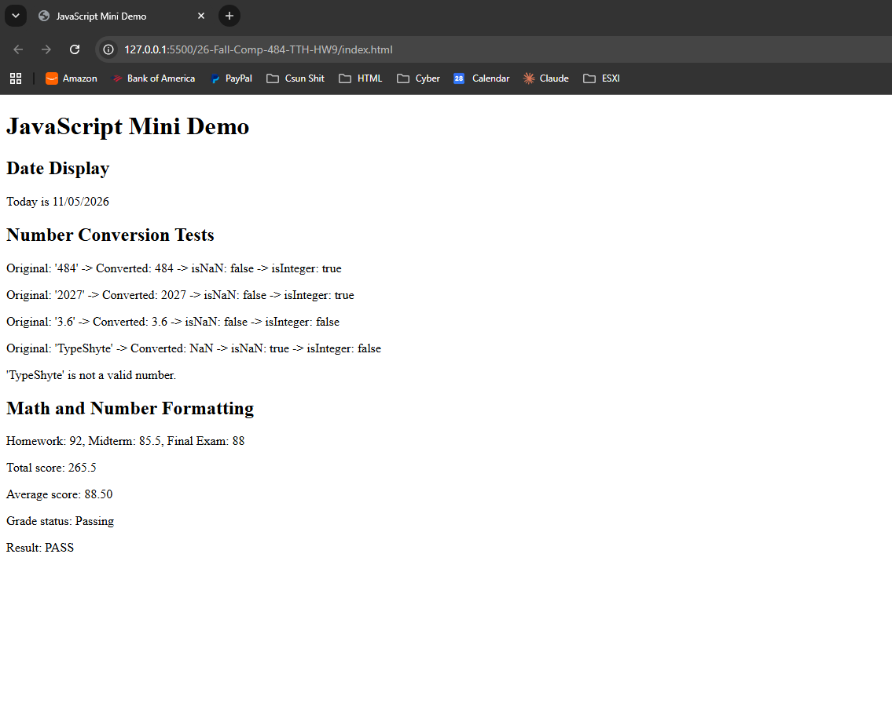

# Homework 9: JavaScript

COMP 484 — Alex Hossepian

## Pages Link

## Screenshot

## Built-in Objects and Methods Used

- For Date I used: `new Date()`, `getMonth()`, `getDate()`, `getFullYear()`
- For Number i usewd: `Number()`, `Number.isNaN()`, `Number.isInteger()`, `toFixed()`
- For document I used: `querySelector()`, `innerHTML`

## Reflection
The easiest part besides the actual html file was the math section. For me it was just easy to conseptialize it after one video.
The hardest part was the date display, since getMonth() starts counting at 0 and I lowkey completely forgot that. I had to add leading zeros so the month and day always showed two digits but I only realized that after asking my friend in another class for help.
I learned that the Date object holds the current date and time, and that I can pull out the month, day, and year separately with differtent methods. From the Number object, I learned that Number() turns strings into numbers, gives NaN when it can't, and that Number.isNaN() and Number.isInteger() can check the result. 
I also learned that I can show results on the page by selecting an element with document.querySelector() and setting its innerHTML. For my first time really diving into javascript ill say that it was hard at first like most languages for me but it got better once I watched break down videos.

## Sources

- COMP 484 lecture slides, Weeks 9–11
- MDN Web Docs: Date, Number(), Number.isNaN(), Number.isInteger(), Number.prototype.toFixed()
- Youtube Alex Toder -  "JavaScript Tutorial: NaN and isNaN()" (This lowkey helped so much)